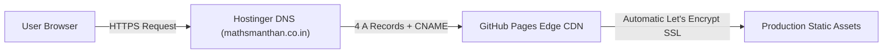

<div align="center">

# 🏛️ Maths Manthan — Official Digital Education Portal
**Premier Mathematics & Science Coaching for CBSE Classes 8 to 12 | Mentored by Manthan Ahlawat**

[](https://mathsmanthan.co.in/)
[](https://mathsmanthan.co.in/)
[](https://maps.app.goo.gl/33ciqPMnbs77ZCjk8)
[](https://www.producthunt.com/products/maths-manthan)
[](https://mathsmanthan.co.in/)

<br>

*A high-performance, modular educational hub delivering chapter test series, master formula handbooks, NCERT digital textbooks, and CBSE board previous year question papers (PYQs) with zero framework bloat.*

</div>

---

## 🌟 Overview & Mission

**Maths Manthan** is an educational institution and digital resource hub founded by **Manthan Ahlawat** in Kankerkhera, Meerut. Designed to build deep conceptual clarity, mathematical intuition, and board examination excellence, the platform pairs physical classroom coaching with an open, accessible digital repository for CBSE students across Classes 8, 9, 10, 11, and 12.

### Key Pillars:
- **Zero-Barrier Access:** Free, instant PDF downloads and in-browser reading without mandatory login walls or paywalls.
- **Ultra-Fast Performance:** Built entirely with lightweight vanilla web standards (HTML5, modular CSS3, and ES6 JavaScript) — achieving 95+ PageSpeed scores and sub-second load times.
- **Mathematical Aesthetics:** Custom 60fps GPU-accelerated canvas streams, dual-theme dark/light glassmorphism, and academic typography.

---

## ✨ Flagship Platform Features

### 🌓 1. Dual-Theme Engine (Dark & Light Mode)
- **Zero-Flash Initialization:** Inline script in the `<head>` checks `localStorage` and system preferences before stylesheet rendering, completely eliminating white-screen flashbangs.
- **Dynamic CSS Variable Architecture:** Smooth transition across backgrounds, glassmorphism cards, and text contrast tokens.
- **Theme-Adaptive Vectors:** Product Hunt, Google Reviews, and trust badges dynamically adapt SVGs and color palettes in real-time.

### 🌌 2. Ambient 60fps Mathematical Canvases
- **Solar Matrix Harmonic Tunnel (`solar-matrix.js`):** Interactive, scroll-reactive 60fps harmonic dot lattice on the homepage with interactive cursor repulsion and physics-based damping.
- **Floating Digit Stream Engine (`matrix-stream.js`):** Lightweight streaming matrix on class and book hubs with customizable density, digit mutation rate, and cursor warp fields.

### 📚 3. Built-In In-Browser PDF Study Reader
- Powered by an integrated **PDF.js** engine with custom modal controls (`View PDF` and `Download` toggles).
- Students can read assignments, NCERT book chapters, and formula handbooks directly in any mobile or desktop browser without leaving the page.

### ⚡ 4. Dynamic Automated PDF Sync Engine (`sync-pdfs.py`)
- Python-powered real-time catalog scanner.
- Automatically scans chapter and book directories in `assets/pdfs/`, indexes all PDF resources regardless of filename conventions, and rebuilds `assets/data/pdf-catalog.json` and `assets/data/chapters-data.json`.
- Can run as a one-shot rebuild or with `--watch` for real-time hot-reloading during content creation.

### 🛡️ 5. Triple Trust Accreditations
- **Product Hunt:** Official featured embed badge with light/dark adaptive rendering.
- **Google 5.0 ★ Verified Reviews:** Interactive card linking directly to Google Business Profile and reviews.
- **NEP 2020 & CBSE Compliance Seal:** Formally aligned with NCERT Ganita Prakash, Ganita Manjari, and NCF-SE syllabus.

---

## 📁 Repository Architecture (15 Production Pages)

```text
MathsManthan/
├── index.html                     # Main Landing Page (Hero, Batches, Educator Profile, WhatsApp Form, Map)
│
├── 🎓 Classroom Test & Assignment Hubs:
│   ├── class-8.html               # Class 8 CBSE Foundation Tests & Formula Sheets
│   ├── class-9.html               # Class 9 CBSE Real Analysis, Coordinate & Algebra Hub
│   ├── class-10.html              # Class 10 Board Exam Chapter Tests & Formula Handbook
│   ├── class-11.html              # Class 11 Senior Secondary Calculus, Sets & Algebra Hub
│   └── class-12.html              # Class 12 Advanced Board Mock Series & Calculus Hub
│
├── 📖 NCERT Complete Books Digital Hub:
│   ├── free-books.html            # Central Master NCERT Digital Library & Complete Books Catalog
│   ├── books-class-8.html         # NCERT Class 8 Ganita Prakash Chapter-wise PDFs
│   ├── books-class-9.html         # NCERT Class 9 Ganita Manjari Chapter-wise PDFs
│   ├── books-class-10.html        # NCERT Class 10 Mathematics & Science Chapter-wise PDFs
│   ├── books-class-11.html        # NCERT Class 11 Mathematics & Exemplar Chapter-wise PDFs
│   └── books-class-12.html        # NCERT Class 12 Mathematics (Parts 1 & 2) Chapter-wise PDFs
│
├── 📝 Specialized Repositories & Legal:
│   ├── cbse-10th-pyqs.html        # Dedicated CBSE 10th Previous 5-Year Board Question Papers
│   ├── privacy.html               # Student Privacy Policy & Data Handling Transparency
│   └── disclaimer.html            # Educational Fair Use & NCERT Copyright Disclaimer
│
├── ⚙️ Automation & Development:
│   ├── sync-pdfs.py               # Dynamic PDF scanner & JSON catalog generator engine
│   ├── update-pdfs.bat            # Windows one-click batch launcher for sync-pdfs.py
│   ├── server.py                  # Local Python development server with CORS/MIME handling
│   ├── sitemap.xml                # Automated XML sitemap (all 15 canonical URLs indexed)
│   ├── robots.txt                 # Search bot indexing directives & crawl optimizations
│   ├── CNAME                      # Custom domain binding (mathsmanthan.co.in)
│   └── .gitignore                 # Exclusion rules for bytecode, caches, and test artifacts
│
└── 🎨 Assets Directory:
    ├── css/
    │   ├── variables.css          # Design tokens (colors, font scales, radii, dark/light vars)
    │   ├── main.css               # Core styling, navbar, educator card, trust bar, footers
    │   └── resources.css          # Resource cards, search filters, PDF reader modal, drawer
    ├── js/
    │   ├── main.js                # Theme switcher, mobile nav, sticky header, WhatsApp generator
    │   ├── resources.js           # Live search, category filters, PDF.js modal handler
    │   ├── solar-matrix.js        # 60fps Solar Matrix harmonic canvas (index.html)
    │   ├── matrix-stream.js       # Mathematical streaming digit canvas (class/book pages)
    │   └── vendor/                # PDF.js worker & runtime binaries
    ├── data/
    │   ├── pdf-catalog.json       # Auto-generated index of all classroom and book PDFs
    │   ├── chapters-data.json     # NCERT syllabus chapter metadata & descriptions
    │   └── class10-formulas.json  # Class 10 quick-reference formula database
    ├── images/
    │   ├── logo.png               # Maths Manthan official brand emblem (Navy & Gold)
    │   ├── manthan-portrait.webp  # Optimized portrait of mentor Manthan Ahlawat
    │   ├── og-banner.png          # 1200x630 vector-rendered WhatsApp / OpenGraph banner
    │   └── favicon*               # Multi-resolution favicons & apple-touch-icons
    └── pdfs/                      # Categorized repository of chapter tests, books, and PYQs
```

---

## 🎨 Design System & Color Palette (60-30-10)

The visual architecture follows the classical **60-30-10 academic harmony rule**, engineered for reading comfort and mathematical focus:

| Role | Color | Hex Code | Purpose |
| :--- | :--- | :--- | :--- |
| **Dominant (60%)** | Deep Oxford Canvas | `#040D1A` (Dark) / `#F8FAFC` (Light) | Foundation background surfaces |
| **Secondary (30%)** | Academic Navy Glass | `#07152B` & `#0A1E3C` | Cards, navigation bars, modal overlays |
| **Accent (10%)** | Manthan Rising Gold | `#DA9B18` (Hover `#D19029`) | CTAs, active badges, highlights, focus rings |

### Typography Tokens:
- **Display & Headings:** `Cinzel`, `Playfair Display`, Georgia (Academic serif authority)
- **Body & User Interface:** `Plus Jakarta Sans`, system-ui (High legibility, modern geometric sans)
- **Signatures & Accents:** `Caveat` (Human mentor warmth)

---

## 🔍 Technical SEO & Social Optimization

- **Structured Data (JSON-LD):** Implemented schema.org `EducationalOrganization`, `Course`, and `BreadcrumbList` on every page for rich Google Search snippet eligibility.
- **Social Graph Optimization:** Custom-crafted `1200x630` high-contrast vector social banner (`assets/images/og-banner.png`) optimized for crisp WhatsApp, Facebook, LinkedIn, and Twitter card previews.
- **Search Verification:** Verified and sitemap-submitted across **Google Search Console** and **Bing Webmaster Tools** (0 crawl errors, full indexing coverage).
- **Analytics:** Integrated Google Analytics 4 (`G-WHKP55SNEB`) for privacy-respecting user journey tracking.

---

## 💻 Local Development Setup

Because the site is built on zero-dependency native web standards, it requires no build steps, bundlers, or `npm install`:

### 1. Clone the Repository
```bash
git clone https://github.com/zoro0308/MathsManthan.git
cd MathsManthan
```

### 2. Start Local Development Server

**Option A: Built-in Python Server**
```bash
python -m http.server 8000
```

**Option B: Using Repository Dev Server**
```bash
python server.py
```

Then open your browser and navigate to:
```text
http://localhost:8000
```

### 3. Adding New Chapter PDFs
Drop your new PDF files into their respective folders in `assets/pdfs/class-X/ch-YY/` and run:
```bash
update-pdfs.bat
```
*(Or run `python sync-pdfs.py`). The catalog will automatically update instantly.*

---

## 🌐 Production Deployment Architecture

The production environment is hosted on **GitHub Pages** with custom apex domain routing via **Hostinger DNS**:



- **Domain:** `https://mathsmanthan.co.in/`
- **DNS Records:** 4 IPv4 A-records pointing to GitHub Pages IP pool (`185.199.108.153`, `185.199.109.153`, `185.199.110.153`, `185.199.111.153`) + `CNAME` pointing apex to `zoro0308.github.io`.
- **SSL/TLS:** Free, auto-renewing Let's Encrypt Certificate enforced with HSTS.

---

## 👨‍🏫 Mentorship & Institute Contact

- **Founder & Mentor:** Manthan Ahlawat *(M.Sc. Mathematics, B.Ed., CTET Qualified)*
- **Offline Center:** European Estate, Kankerkhera, Meerut, Uttar Pradesh - 250001
- **Direct Contact / WhatsApp:** [+91 8171546558](https://wa.me/918171546558)
- **Official Email:** [contact@mathsmanthan.co.in](mailto:contact@mathsmanthan.co.in)
- **Website:** [https://mathsmanthan.co.in](https://mathsmanthan.co.in)

---

<div align="center">
  <sub>&copy; 2026 Maths Manthan. All Rights Reserved. • Designed for Academic Excellence.</sub>
</div>
